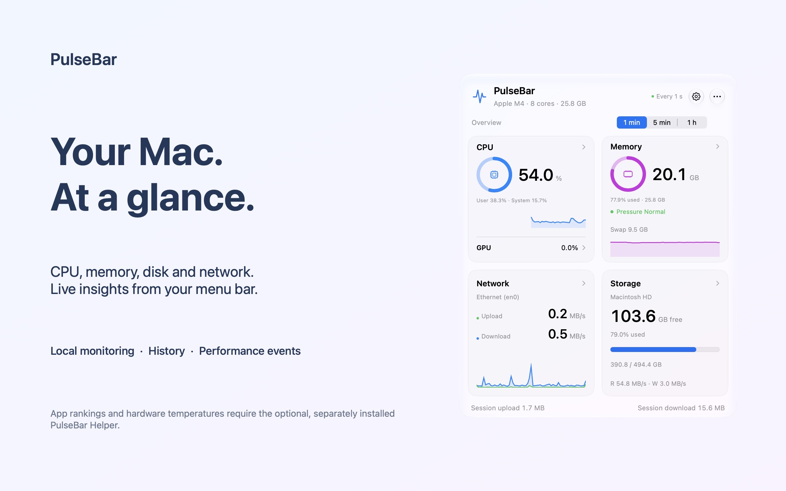
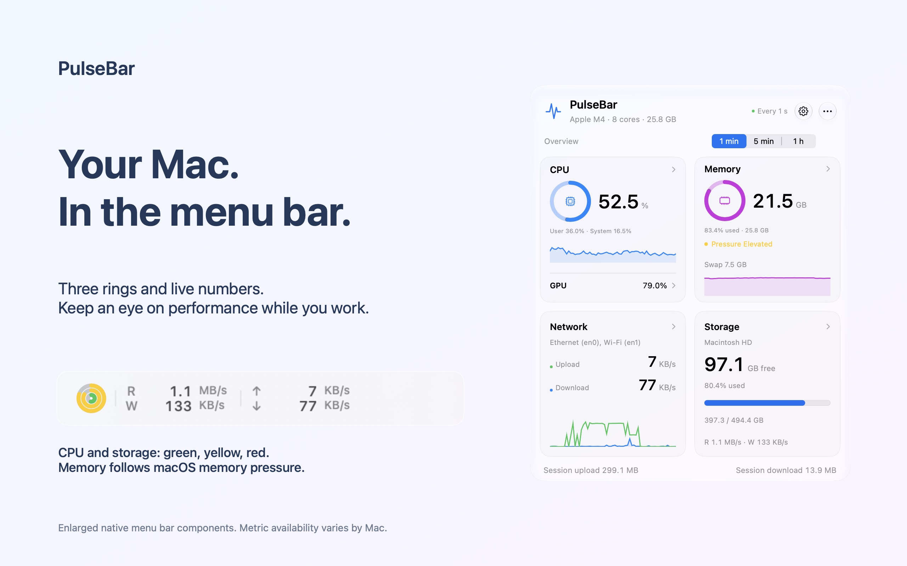
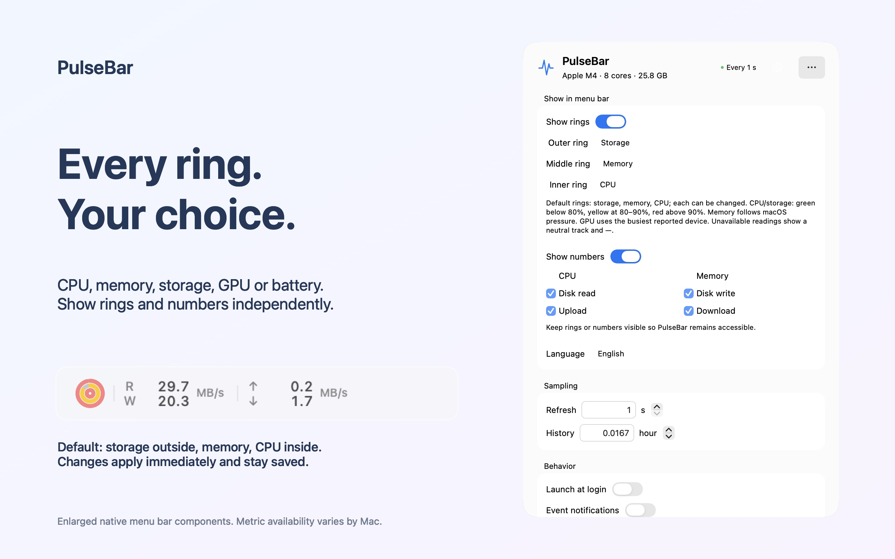
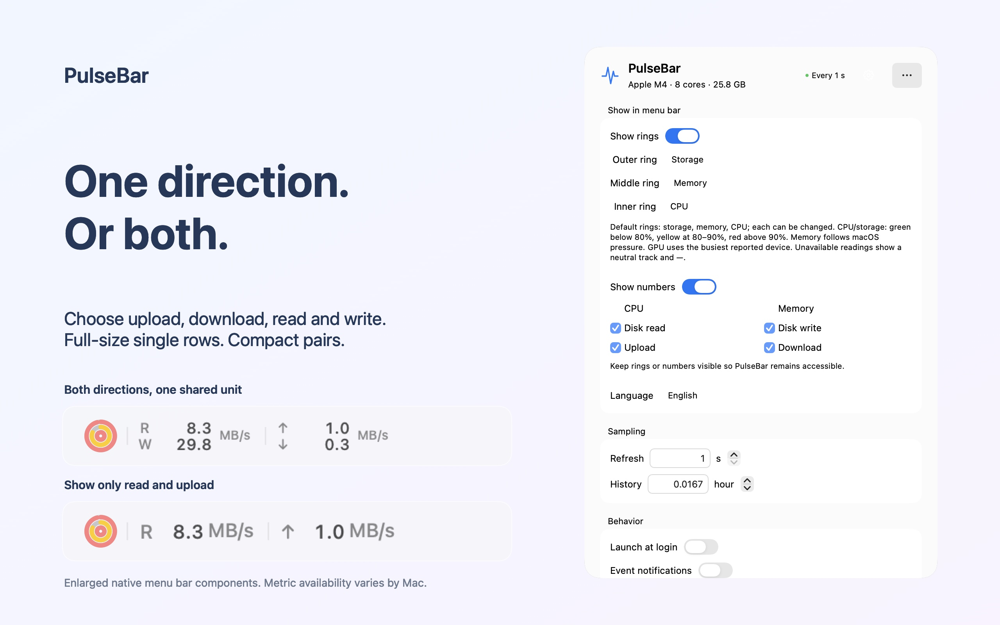

# PulseBar

English | [简体中文](README.zh-CN.md)

A macOS menu bar monitor for CPU, memory, storage and network, with history charts and local performance events. The optional [PulseBar Helper](docs/HELPER.md) adds app rankings and hardware temperatures.

[Hardware compatibility](docs/HARDWARE-MODULES.md) · [Privacy](docs/PRIVACY.md) · [Distribution guide](docs/APP-STORE.md)

## See PulseBar in action

Three configurable rings and independent numeric readings keep the menu bar focused on what matters to you. Click the readings for the live overview, then open Settings to choose each ring and rate direction.

<table>
<tr>
<td width="50%"><br />Live overview</td>
<td width="50%"><br />Menu bar at a glance</td>
</tr>
<tr>
<td width="50%"><br />Choose each ring</td>
<td width="50%"><br />Choose one rate direction or both</td>
</tr>
</table>

## Download and install

Install **PulseBar from the Mac App Store**. The main app and its updates are no longer published on GitHub.

Requires **macOS 13 or later**, on **Apple Silicon or Intel**. The optional Helper provides app rankings and hardware temperatures; basic monitoring works without it.

**[Download the Helper installer](https://github.com/monaco-io/PulseBar/releases/download/helper-v1.0.2/PulseBar-Helper.pkg)** · [Helper setup](docs/HELPER.md)

Open the PKG and follow macOS Installer. The helper installs in your home folder’s Applications folder. In PulseBar Settings, choose **Open Helper**, then **Enable Helper**.

### Software updates

PulseBar updates through the **Mac App Store**. Update the Helper with its separate installer.

## Features

- **Hardware:** CPU, memory, pressure, swap, storage, disk I/O and network rates; GPU and internal battery where supported.
- **Menu bar:** three customizable rings and individual CPU, memory, read, write, upload and download numbers.
- **Overview:** four tiles for CPU/GPU, memory, network and storage, with separate detail windows.
- **App rankings and temperatures:** available with the Helper. [Sensor compatibility](docs/TEMPERATURES.md).
- **History:** inspect samples, averages and peaks over up to 24 hours from the current session.
- **Events:** sustained CPU ≥ 85% for 30 seconds or elevated memory pressure for 10 seconds. Stored locally for 7 days, up to 200 events; notifications are optional.

## Using PulseBar

Open PulseBar, then click its menu bar readings for the overview. Hover over or click a hardware tile for details. The gear opens Settings; More opens Events, Reset and Quit. Click outside or press Escape to close.

Command-2 opens CPU details, Command-3 opens Events, and Command-4 opens Settings. Reopening the app brings up its existing instance.

| Setting | Behavior |
| --- | --- |
| Menu bar | Choose ring metrics and visible numbers. |
| Language | System, English or Simplified Chinese. |
| Refresh | Every 1–60 seconds; default 2 seconds. |
| History | Up to 24 hours; `0.5` means 30 minutes. |
| Launch at login | Off until enabled. |
| Event notifications | Optional, with a cooldown per event type. |
| Software update | Managed by the App Store. |

Settings are saved automatically. **Reset** clears charts and session disk/network totals, keeping events. Network and disk rates each offer **Automatic** (default) or **Fixed MB/s**. Automatic chooses KB/s, MB/s or GB/s independently for each direction; paired menu-bar rows each show a unit, while a single row keeps its full-size unit. Rates use binary divisors and iStat-style precision; capacity and session totals retain decimal units (`1 GB = 1000 MB`). Unsupported hardware readings are hidden.

## Build and run

Install Xcode Command Line Tools (`xcode-select --install`). Builds require Swift 6.0 or later. Monitoring uses system frameworks; updates use Sparkle 2.10.0. SwiftPM downloads the pinned official binary dependency and verifies its SHA-256.

```sh
./scripts/build-app.sh
open dist/PulseBar.app
```

The build creates a universal arm64/x86_64 development app and ZIP in `dist/`, with ad-hoc signing. For the Store build and signed Helper installer, see the [release guide](docs/RELEASING.md).

```sh
./scripts/swift-local.sh test --disable-xctest
dist/PulseBar.app/Contents/MacOS/PulseBar --sample 5
dist/PulseBar.app/Contents/MacOS/PulseBar --sample 3 --interval 6
```

Diagnostic sampling outputs NDJSON with interface counters, `cpu`, `memory`, `disk`, `memoryPressure`, `swap`, `apps`, `temperatures`, `gpuUsage`, `storageCapacity`, and `battery`. Each temperature entry contains `component`, `celsius`, and contributing `sensorIDs`. GPU entries contain device identity, name, and `utilizationPercent`; capacity contains the sampled volume's name/path and byte counts; battery contains optional charge, power state, maximum-capacity percentage, cycles, and a time estimate in minutes. Missing temperatures/GPU readings produce empty arrays; unavailable capacity/battery produce `null`, and individual unavailable battery fields are also `null`. Optional hardware absence does not cause diagnostic errors. Capacities/totals use bytes, I/O rates use bytes per second, utilization uses 0–100%, and temperatures use °C. Initial CPU/disk rates are `null` while baselines are established. `--interval` affects diagnostic sampling only, including an optional hardware read attempt per sample (subject to temperature-reader retry delays); the panel's slower hardware cadences do not apply. This mode opens no UI, records no events, and sends no notifications. Core metrics fail independently, reporting errors and a nonzero exit code after the remaining sampling completes. See the [diagnostic field reference](docs/HARDWARE-MODULES.md#diagnostic-fields).

The wrapper handles some Command Line Tools installations with duplicate `SwiftBridging` definitions or older `PackageDescription` interfaces. Compatibility files stay in `.build`; system toolchains are untouched. Standard toolchains can also use `swift build` and `swift test` directly.

## Measurement scope and privacy

- **CPU:** differences in Mach `HOST_CPU_LOAD_INFO` counters, normalized across all logical cores to a whole-Mac 0–100% scale.
- **Memory:** `HOST_VM_INFO64` app memory (internal pages minus purgeable pages), wired memory, and physical compressed pages. File cache is excluded, and uncompressed size is not counted again. Usage percentage is separate from memory pressure. See [Apple's memory terminology](https://support.apple.com/guide/activity-monitor/view-memory-usage-actmntr1004/mac).
- **Apps:** accessible process counters from `proc_pid_rusage` and process identity APIs. Helpers and WebKit/XPC services are grouped under their app using the executable's outermost `.app`, macOS responsibility information, then the parent chain. Responsibility uses an optional, dynamically resolved system SPI; when unavailable or an owner cannot be resolved, the existing bundle/parent lookup remains and unmatched services appear separately. Owner identity does not require readable owner counters. CPU Mach ticks are converted using `mach_timebase_info`; memory uses `ri_phys_footprint` and cannot be summed to reconcile system memory totals. Exited or inaccessible processes are skipped.
- **Pressure and swap:** direct readings from `kern.memorystatus_vm_pressure_level` and `vm.swapusage`. Pressure is never inferred from memory usage percentage.
- **GPU:** driver-reported `PerformanceStatistics` / `Device Utilization %` from named hardware `IOAccelerator` services. Values are shown per device on a 0–100% scale; percentages from multiple GPUs are not added together. These driver keys are not guaranteed across Macs or macOS versions. A component-wide GPU temperature is not attributed to a particular device row.
- **Temperatures:** read-only AppleSMC queries through IOKit. Only known component mappings and supported temperature encodings are accepted; invalid, zero, or unavailable readings are omitted. Each displayed component uses the maximum of its currently valid mapped sensors. Memory pressure and macOS thermal state are never converted into temperatures. Apple Silicon has been sampled locally; Intel temperature sensors have not been tested on Intel hardware. See [implementation and compatibility](docs/TEMPERATURES.md).
- **Storage capacity:** Foundation `volumeTotalCapacity` and ordinary `volumeAvailableCapacity` on `/System/Volumes/Data`, or `/` when there is no separate startup data volume. This is capacity visible to the startup volume, rather than the physical drive's nominal capacity or a sum of APFS volumes. On APFS, unavailable space includes other volumes and snapshots sharing its container. Available space excludes estimated reclaimable space from `volumeAvailableCapacityForImportantUsage`.
- **Disk I/O:** physical-device counters from IOKit's `IOBlockStorageDriver`, without adding APFS volumes or partitions again. Virtual interfaces are excluded; cached reads may not cause physical I/O. This system-wide device activity has a different scope from startup-volume capacity.
- **Network:** kernel `NET_RT_IFLIST2` counters for active `en<N>` interfaces, including Wi-Fi, Ethernet, and common USB adapters. Local traffic and protocol overhead are included. Virtual interfaces are not counted again; VPN transport remains counted on the physical interface.
- **Internal battery:** public IOPowerSources descriptions establish one present internal host battery before optional AppleSmartBattery capacity/cycle metadata is used. Charge and power state use the same public source; time comes from its official charging/discharging estimates. Maximum capacity compares compatible native full-charge and design-capacity values, rather than assigning a health score. Unavailable or incompatible fields are hidden. A desktop without an internal battery has no battery section.

All sampling uses in-process system APIs. PulseBar does not capture packets, read browsing content or process command lines, run active speed tests, send monitoring telemetry, or request administrator access. Process sampling and event writes run on a serial background queue.

Baselines reset after device changes, counter resets, sleep, or interrupted sampling to avoid artificial spikes. Charts preserve peaks when reducing plotted points and exclude missing time from averages. Events use observed sample duration, so longer intervals delay detection and brief events between samples may be missed. Event snapshots are stored atomically in `~/Library/Application Support/PulseBar/events.json` and are never uploaded.

## Localization

Public project information and release notes default to English. Chinese documentation is available through explicit language links. App localization is available through the language setting.

Translations live in `Sources/SpeedCore/Resources/{en,zh-Hans}.lproj/Localizable.strings`; localized app names are in `Resources/*.lproj/InfoPlist.strings`. Settings use UserDefaults. The original NetSpeed bundle identifier is retained to preserve existing preferences and menu bar placement.

PulseBar uses AppKit `NSStatusItem`/`NSPopover` with a SwiftUI panel. Kernel structures follow the installed SDK's `net/if.h` and `net/if_var.h`.
