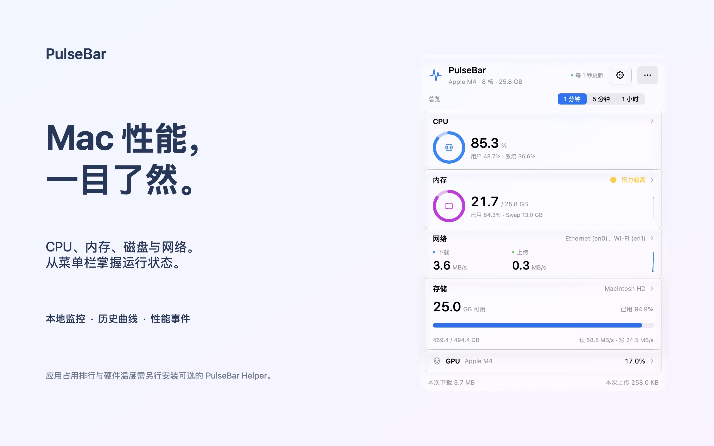
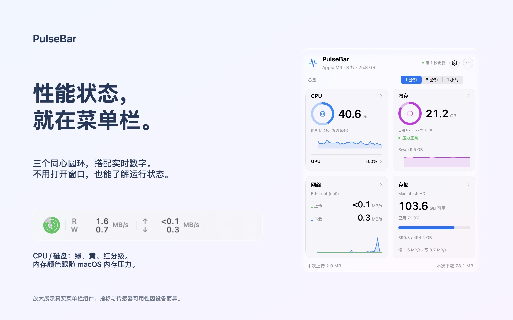
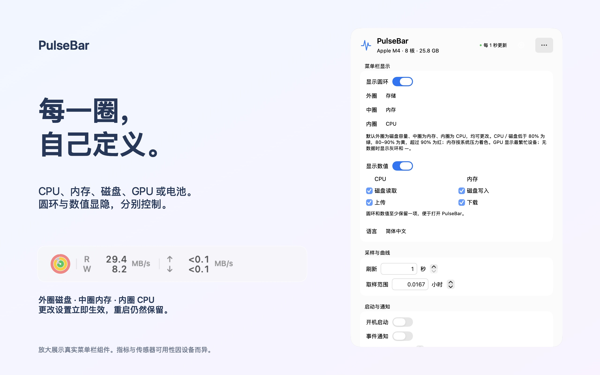
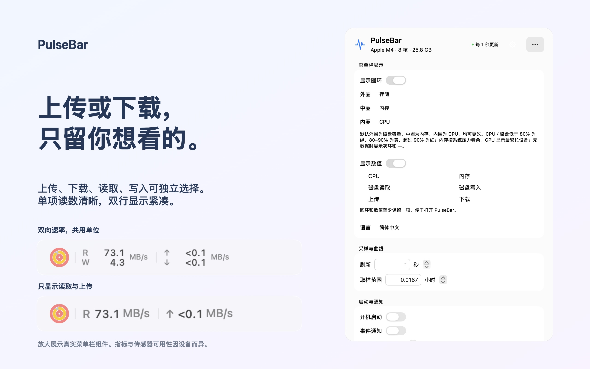

# 脉动 · PulseBar

[English](README.md) | 简体中文

macOS 菜单栏性能监控，显示 CPU、内存、存储与网络，提供历史曲线和本地性能事件。可选的 [PulseBar 助手](docs/HELPER.md)提供应用排行和硬件温度。

[硬件兼容性](docs/HARDWARE-MODULES.md) · [隐私说明](docs/PRIVACY.md) · [商店分发指南](docs/APP-STORE.md)

## 看看实际界面

三个圆环与数值分别控制显隐，每一圈都能自选指标。上传、下载、磁盘读取和写入也可独立选择；点击菜单栏打开实时总览，在设置中即时调整。

<table>
<tr>
<td width="50%"><br />实时总览</td>
<td width="50%"><br />菜单栏性能读数</td>
</tr>
<tr>
<td width="50%"><br />自定义每个圆环</td>
<td width="50%"><br />独立选择速率方向</td>
</tr>
</table>

## 下载安装

**PulseBar 主程序通过 Mac App Store 安装和更新，后续不再发布 GitHub 主程序版本。**

支持 **macOS 13+，Apple Silicon 和 Intel**。可选助手提供应用排行和硬件温度，不安装也可以使用基础监控。

**[直接下载助手安装包](https://github.com/monaco-io/PulseBar/releases/download/helper-v1.0.2/PulseBar-Helper.pkg)** · [助手安装说明](docs/HELPER.md)

打开 PKG 并按 macOS 提示安装。助手位于个人“应用程序”文件夹；在 PulseBar 设置中选择“打开助手”，再选择“启用助手”。

### 软件更新

主程序通过 **Mac App Store 更新**，助手使用单独的安装包更新。

## 功能

- CPU、内存、内存压力、Swap、存储容量、磁盘读写和网络速率；设备支持时显示 GPU 与内置电池信息。
- 三个自定义圆环，CPU、内存、读取、写入、上传和下载数值独立显示。
- CPU/GPU、内存、网络、存储四块总览，分别打开详情窗口。
- 启用助手后显示应用排行及硬件温度。[温度兼容性](docs/TEMPERATURES.md)。
- 查看本次运行最长 24 小时的曲线、均值与峰值。
- CPU ≥ 85% 持续 30 秒，或内存压力偏高、紧张持续 10 秒时记录事件。本机保留 7 天、最多 200 条，可选通知。

## 使用

打开 PulseBar，点击菜单栏读数查看总览。悬停或点击硬件模块查看详情。齿轮打开设置，“更多”打开事件、重置和退出。点击外部或按 Escape 关闭。

Command-2 / 3 / 4 分别打开 CPU 详情、事件和设置。重复启动会打开已有实例。

| 设置 | 功能 |
| --- | --- |
| 菜单栏 | 选择圆环指标与显示的数值。 |
| 语言 | 跟随系统、英文或简体中文。 |
| 刷新 | 每 1–60 秒，默认 2 秒。 |
| 取样范围 | 最长 24 小时，`0.5` 表示 30 分钟。 |
| 开机启动 | 手动启用后随登录启动。 |
| 事件通知 | 同类事件在冷却时间内不重复通知。 |
| 软件更新 | 由 App Store 管理。 |

设置自动保存。“重置”清空曲线与本次流量、读写累计，保留事件。网络与磁盘速率分别支持“自动”（默认）和“固定 MB/s”：自动模式下各方向独立选择 KB/s、MB/s 或 GB/s；菜单栏双行分别显示单位，单行保留大字号单位。速率采用二进制换算及 iStat 的小数位规则；容量和累计量仍按十进制换算（1 GB = 1000 MB）。不支持的硬件读数自动隐藏。

## 构建和运行

监控功能使用系统框架，软件更新使用 Sparkle 2.10.0。安装 Xcode Command Line Tools（`xcode-select --install`），Swift 6.0 或更新版本即可构建。首次构建从 Sparkle 官方 Release 下载固定版本的二进制依赖，SwiftPM 校验其 SHA-256。

```sh
./scripts/build-app.sh
open dist/PulseBar.app
```

构建生成通用 arm64/x86_64 开发版 `dist/PulseBar.app` 与 ZIP，使用本地 ad-hoc 签名。商店构建和签名助手安装包见[发布说明](docs/RELEASING.zh-CN.md)。

```sh
./scripts/swift-local.sh test --disable-xctest
dist/PulseBar.app/Contents/MacOS/PulseBar --sample 5
dist/PulseBar.app/Contents/MacOS/PulseBar --sample 3 --interval 6
```

采样命令输出 NDJSON，包括原有网卡计数和速率字段，以及 `cpu`、`memory`、`disk`、`memoryPressure`（1 正常 / 2 偏高 / 4 紧张）、`swap`、`apps`（前五名排行、已采样与不可读取进程数）、`temperatures`，以及 `gpuUsage`、`storageCapacity` 和 `battery`。GPU 为设备数组，缺失为 `[]`；容量和内置电池缺失为 `null`，这些可选硬件缺失不会报错。温度数组每项包含 `component`、`celsius` 和参与计算的 `sensorIDs`；无有效读数时为 `temperatures: []`，温度缺失本身不会使诊断报错。用量和 I/O 的诊断原始数据仍以字节和字节每秒计量，温度采用 °C；界面速率按网络或磁盘设置选择单位，容量及累计自动选择单位。首次 CPU 和磁盘速率为 `null`，应用 CPU 排行等待基线。`--interval` 指定诊断采样秒数，默认 1，不修改 App 设置；每次诊断采样都会尝试读取温度（受不可用传感器重试等待限制），也每次尝试 GPU、容量及电池，不受面板最快 5 / 30 秒一次的限制。诊断路径不记录事件、不发送通知。各指标独立读取；失败写入 `errors`，继续采样其他指标，最终返回非零退出码。不会启动额外界面。

构建入口兼容部分 Command Line Tools 升级后残留的重复 `SwiftBridging` 模块定义和旧 `PackageDescription` 私有接口。兼容文件仅生成在项目 `.build` 中，不修改系统工具链。正常工具链也可以直接执行 `swift build` 和 `swift test`。

## 统计范围

### 应用排行、内存压力和事件

通过 `proc_listallpids`、`proc_pidinfo`、`proc_pidpath` 和 `proc_pid_rusage` 读取当前可访问进程的身份及计数，不读取命令行参数或进程内容。CPU 累计值先按 `mach_timebase_info` 从 Mach tick 转为纳秒，再按实际经过时间及逻辑核心数归一化为整机 0–100%，不采用活动监视器的“单核心 100%”口径。首次采样、新进程、PID 复用、计数回退或采样中断均重新建立基线。内存采用 `ri_phys_footprint`；与系统已用内存统计范围不同，不能直接相加对账。

可执行路径中的最外层 `.app` 优先标识应用；没有自身应用路径的进程先查询 macOS 的责任应用信息，再沿父进程链查找。这样由 launchd 托管的 WebKit/XPC 服务也能计入各自所属的 Safari、钉钉等应用，合计 CPU、内存和进程数。责任应用查询使用动态解析的可选系统 SPI，并非公开 SDK 接口；不可用或无法确认所属应用时保留路径和父进程查找，仍无法归属的服务按可执行路径单列。读取所属应用身份不依赖该应用的资源计数是否可访问。已退出或权限限制导致无法读取的进程会被跳过，面板显示统计覆盖数量；不申请管理员权限。进程采样和事件落盘使用独立串行后台队列。

压力读取 `kern.memorystatus_vm_pressure_level`，其返回值是用户空间压力标志，见 [Apple XNU 实现](https://github.com/apple-oss-distributions/xnu/blob/main/bsd/kern/kern_memorystatus_notify.c)。Swap 读取 `vm.swapusage`。压力与内存占用率互相独立，含义参考 [Apple 内存说明](https://support.apple.com/en-gb/guide/activity-monitor/actmntr1004/mac)。

事件按采样覆盖的持续时间判定，较长刷新间隔会推迟检测；两个样本之间发生并恢复的状态可能无法观察到。事件存于 `~/Library/Application Support/PulseBar/events.json`，采用原子写入，记录时间、指标和排行，不上传。通知使用系统 UserNotifications，仅在用户主动开启时请求授权。

### CPU 和内存

CPU 使用 Mach `host_statistics(HOST_CPU_LOAD_INFO)` 的用户、系统、空闲和 nice 累计 tick 差值计算，所有逻辑核心合计归一化为 0–100%，不是启动以来的平均值。CPU 曲线和内存曲线固定为 0–100%。

内存使用 [`host_statistics64`](https://developer.apple.com/documentation/kernel/1502863-host_statistics64) 的 `HOST_VM_INFO64` 和本机页大小：已用 = 应用（anonymous/internal 页扣除 purgeable 页）+ 联动（wired）+ 压缩数据实际占用页。不把文件缓存算作已用，也不把压缩前大小重复相加；占用百分比不等同于内存压力。分类含义参考 [Apple 活动监视器说明](https://support.apple.com/guide/activity-monitor/view-memory-usage-actmntr1004/mac)。

### 硬件温度

通过 IOKit 对 AppleSMC 发出只读查询，只接受已知部件映射、支持的温度编码和有效读数；零值、无效值或不可访问的读数直接省略，每项显示当前有效映射传感器的最高温度。不会将内存压力或 macOS 热状态当作温度。已在本机 Apple Silicon 读取真实传感器；尚未在 Intel 真机验证温度传感器。无需管理员权限或特权辅助服务；接口不可访问时隐藏温度，其他监控继续运行。详见[实现与兼容性](docs/TEMPERATURES.md)。

### 磁盘 I/O

通过 IOKit 枚举 `IOBlockStorageDriver`，读取 [`Statistics` 的 `Bytes (Read)` / `Bytes (Write)`](https://github.com/apple-oss-distributions/IOStorageFamily/blob/main/IOBlockStorageDriver.h) 64 位计数，按实际采样间隔计算物理设备读写速率。合计内置和外接磁盘，不叠加 APFS 卷 / 分区；排除报告为 `Virtual Interface` 的设备。这里监测磁盘传输，不是磁盘空间占用或仅某个进程的文件操作；命中文件缓存的读取不一定产生物理 I/O。

各磁盘通过 IORegistry ID 独立建立基线，重新接入或 BSD 名称复用时不把历史字节数计入当前速率。磁盘曲线独立缩放，磁盘和网络速率单位分别跟随设置中的“自动”或“固定 MB/s”。

### 网络

读取 macOS 内核 `NET_RT_IFLIST2` 的 64 位收发计数，按配置的间隔采样并根据实际经过时间计算速率。合计处于 UP/RUNNING 状态的 `en<N>` 网卡（Wi-Fi、有线、常见 USB 网络适配器），并通过 SystemConfiguration 排除已知未连接的网口。包括局域网流量和协议开销。

不重复累加 `utun`、回环、网桥和 AirDrop 虚拟接口；VPN 的实际传输仍由底层物理网卡计入。不会捕获数据包、读取访问内容、发送遥测、主动测速或要求管理员权限。

所有采样都在进程内调用系统接口，不启动周期性子进程。网络流量和磁盘读写的“本次累计”从启动或重置开始，退出后清零。切换设备、计数器重置、休眠唤醒或采样中断超过允许阈值时重新建立基线，避免虚假峰值；基线间隔不计入累计。阈值随刷新间隔调整，较长的正常采样不会被误判成停顿；更改刷新间隔保留累计。CPU 和磁盘采样异常同样会丢弃旧基线；内存恢复后直接显示最新值。保留最近 24 小时及其边界前的一个采样点；显示时按所选时间范围裁剪和插值，使较长刷新周期下仍可正确绘制窗口边界。较长曲线根据绘图宽度选取双向极值，保留峰值并限制实际绘制的点数。

## 多语言资源

翻译位于 `Sources/SpeedCore/Resources/{en,zh-Hans}.lproj/Localizable.strings`，应用名称的系统语言翻译位于 `Resources/*.lproj/InfoPlist.strings`，采用 [Swift Package 本地化资源](https://developer.apple.com/documentation/xcode/localizing-package-resources)。构建脚本将资源包复制到 App 内，分发后的应用不依赖开发目录。设置通过 UserDefaults 保存，菜单栏设置使用 `menuBarDisplayVersion`、`menuBarNumberMetrics`、`menuBarShowsRings`、`menuBarShowsNumbers`、`menuBarOuterRingMetric`、`menuBarMiddleRingMetric` 和 `menuBarInnerRingMetric`，并迁移旧 `menuBarMetrics`；语言、刷新与历史范围继续使用 `appLanguage`、`refreshSeconds` 和 `historySeconds`。从原 NetSpeed 更新时沿用应用标识，保留既有设置和菜单栏位置。

实现由 AppKit 的 [NSStatusItem](https://developer.apple.com/documentation/appkit/nsstatusitem) / [NSPopover](https://developer.apple.com/documentation/appkit/nspopover) 承载 SwiftUI 面板。内核数据结构以本机 SDK 的 `net/if.h` 和 `net/if_var.h` 为准。
